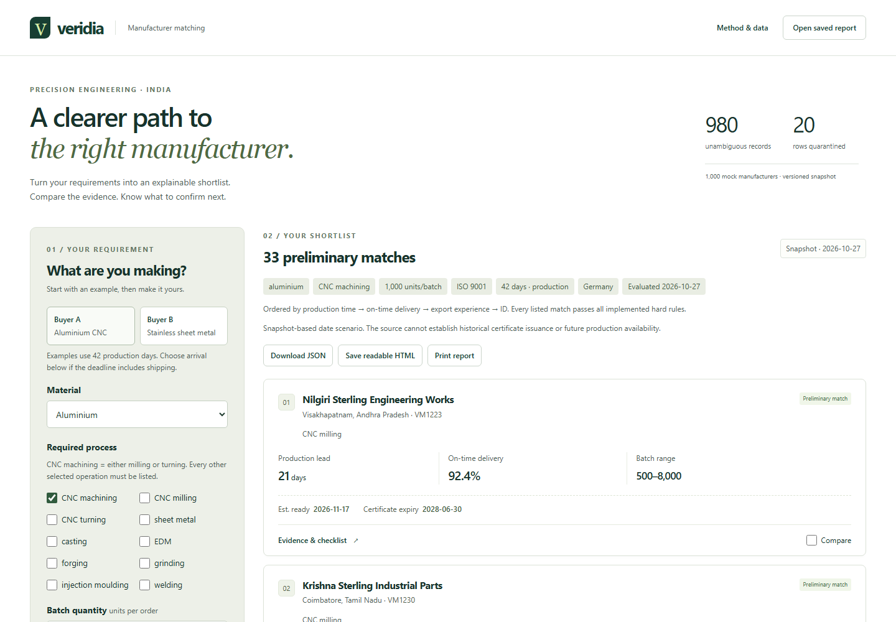

# Veridia | Manufacturer Matching

Veridia helps buyers and sourcing engineers shortlist Indian manufacturers for precision engineering orders. It checks a requirement against a supplied manufacturer dataset, explains why each supplier qualifies, and highlights the questions that still need supplier confirmation.

The application runs in the browser using a mock dataset of 1,000 manufacturer records. Matching uses explicit, repeatable rules. No backend, database, API key or external AI service is required.



## Features

- **Requirement-based matching:** Filter by material, manufacturing processes, batch quantity, required certificates and production lead time.
- **Supplier comparison:** Compare up to three manufacturers side by side, including capabilities, timing, delivery history and supporting evidence.
- **Clear explanations:** Review individual eligibility checks, data issues and reasons for exclusion. Near matches appear separately from the qualified shortlist.
- **Confirmation checklists:** Track questions about drawings, tolerances, certificates, production slots and recurring orders for each supplier.
- **Reports and saved reviews:** Export JSON, save a standalone HTML report, or print to PDF. Reopen a saved JSON report and explicitly verify it against the same dataset and matching policy.
- **Independent buyer sessions:** Each browser tab has its own requirements, results and review progress. Matching runs in a Web Worker, and outdated responses cannot replace newer results.

## Getting started

Install **Node.js 24 or newer** with npm. Clone or download the repository, then open a terminal in the project root:

```sh
npm ci --cache ./.cache/npm
npm run data:prepare
npm run dev
```

The cache option keeps dependency downloads inside the project. Open the address printed by Vite, usually <http://127.0.0.1:5173>.

### Try the sample requirements

Set **Evaluation date** to **27 October 2026**, then choose **Buyer A** or **Buyer B**. Selecting an example runs matching immediately.

| Example | Requirement | Expected preliminary matches |
| --- | --- | --- |
| Buyer A | Aluminium, CNC machining, 1,000 units, ISO 9001, 42 production days | 33 manufacturers |
| Buyer B | Stainless steel, sheet metal, 1,500 units, ISO 9001, 42 production days | VM1006 only |

Both examples use six weeks as **42 production calendar days**, excluding shipping. The evaluation date affects certificate validity, so use the date above to reproduce these results.

Open **Evidence & checklist** on a supplier card to review the result. Select up to three **Compare** checkboxes, then choose **Compare suppliers**. Editing a requirement marks the previous results as outdated and clears comparison selections and checklist progress.

## How matching works

Eligibility is checked before ranking. A manufacturer must have an unambiguous identity, active status, the requested material and processes, a batch range that includes the order quantity, all required certificates, and a known production lead time within the requested window.

The rules handle several details explicitly:

- **Processes:** The grouped **CNC machining** option accepts either milling or turning. Selecting specific operations requires every selected operation to be listed.
- **Certificate validity:** Requested certificates must remain valid through estimated production completion, including the expiry day. Completion assumes an immediate start on the evaluation date. The supplier's single recorded expiry date applies to all listed certificates. Clearing all certificate selections removes this filter.
- **Missing information:** A supplier with no failed checks but unknown required information is marked **Needs confirmation** and stays outside the qualified shortlist.
- **Deadlines:** Lead times use UTC calendar days. An arrival deadline screens production timing only; shipping and customs remain unconfirmed.
- **Recurring orders:** The first batch is evaluated separately. Certificate renewal needs and monthly volume above nominal capacity produce warnings for follow-up.

Qualified manufacturers are ranked by:

1. Shortest production lead time.
2. Highest valid on-time delivery percentage.
3. Most years of export experience.
4. Manufacturer ID as a stable tie-breaker.

Unknown ranking metrics follow known values when earlier criteria are equal. The ordering is visible in the interface.

## Dataset and data quality

The source file, `veridia_csv.csv`, contains **1,000 rows and 31 columns**. The preparation script normalizes the CSV and generates `data/prepared.json` and `data/quality.json`. Original field values, source row numbers and validation issues are retained. A SHA-256 hash identifies the source snapshot.

| Issue in the supplied data | Treatment |
| --- | --- |
| 20 rows share conflicting manufacturer IDs | All affected rows are quarantined, leaving 980 records for requirement-specific screening. |
| 10 rows have no production lead time | Timing remains unknown; these rows cannot qualify for the shortlist. |
| 10 rows have on-time delivery above 100% | The invalid metric is treated as unknown and cannot improve ranking. |

To update the dataset, replace the source CSV while preserving its expected schema, then run `npm run data:prepare`. Run this command before unit tests after a CSV change; production builds also regenerate the data automatically. See the [data-quality report](docs/data-quality.md) for validation rules and source limitations.

## Reports and review progress

**Download JSON** saves the evaluated requirement, all qualified results, the near-match sample, supplier evidence, comparison selections, checklist wording and progress, plus dataset and policy versions.

**Save readable HTML** creates a standalone report. **Print report** opens a preview with supplier selection and an optional near-match appendix, then supports the browser's **Print / Save as PDF**. Readable reports include selected suppliers, or the top three by default; choose **All matching suppliers** for the full shortlist. These choices do not reduce the JSON export.

**Open saved report** accepts schema-validated JSON up to 5 MB. Imported reports are labelled as unverified records. **Recalculate & verify replay** is available only when the dataset hash, dataset version and policy version match. An identical result preserves review progress; changed results clear it. Saved files are unsigned, so validation does not authenticate their contents.

Requirements and review progress stay in memory in the current tab. **Export before closing or reloading the page** to retain your work. Matching works offline after the page and worker have loaded. Offline reloading is not supported, and the HTML exporter must be loaded once before disconnecting if needed offline.

## Technology and project structure

The frontend uses **React 19, TypeScript, Vite and Tailwind CSS**. **Papa Parse** handles CSV parsing, **Zod** validates data and saved reports, and a browser **Web Worker** runs the matching engine. Tests use **Vitest** and **Playwright**, with **ESLint** for linting.

| Path | Responsibility |
| --- | --- |
| `src/App.tsx`, `src/components/` | Requirement form, results, comparison, checklists and report views |
| `src/lib/data/` | CSV normalization, validation and source provenance |
| `src/lib/matching/` | Eligibility rules, ranking and checklist generation |
| `src/workers/` | Browser worker for matching requests |
| `src/lib/reports/` | Saved-record validation, replay checks and HTML export |
| `src/lib/schema.ts` | Shared schemas, supported values and version definitions |
| `data/` | Prepared dataset and quality summary |
| `scripts/prepare-data.ts` | Reproducible data preparation |
| `tests/`, `e2e/` | Unit tests and browser tests |
| `docs/` | Product decisions, data-quality notes, verification records and screenshots |

## Development and verification

| Command | Purpose |
| --- | --- |
| `npm run dev` | Start the local development server |
| `npm run data:prepare` | Regenerate the normalized dataset and quality summary |
| `npm run lint` | Run ESLint |
| `npm run typecheck` | Check TypeScript types |
| `npm test` | Run unit tests |
| `npm run build` | Prepare data, check types and build the production app |
| `npm run test:e2e` | Run Chromium tests against an existing production build |
| `npm run check` | Run lint, unit tests, production build and browser tests |
| `npm run preview` | Serve the production build locally |

Install the test browser once, then run the full checks:

```sh
npx playwright install chromium
npm run check
```

The first browser installation requires internet access. Playwright starts the production preview at `http://127.0.0.1:4173`; keep that port available when running browser tests.

Coverage includes matching boundaries, certificate dates, ranking, data validation, both buyer examples, saved reports, replay, independent sessions, outdated worker responses, comparison and mobile interactions. Recorded results and verification limits are available in [docs/verification.md](docs/verification.md).

## Production build

```sh
npm run build
npm run preview
```

Deploy the generated `dist/` directory to a static web host. Vite uses relative asset paths by default, so the build supports hosting under a repository subpath. Set `VITE_BASE_PATH` at build time if the host requires an explicit base path. No application server or runtime credentials are needed.

## Scope and limitations

This project supports an initial sourcing review using mock data. Supplier availability, certificate authenticity, material grades, drawings and tolerances still require direct confirmation. General export experience does not establish experience with a particular destination, and date-based evaluations use the supplied snapshot rather than historical records.

Listed monthly capacity does not represent available capacity. For example, VM1006 appears for both sample buyers: their combined batches total 2,500 units against a nominal capacity of 1,500 units per month. The dataset has no bookings or start dates to determine whether both orders fit within six weeks. Matching does not reserve or allocate production capacity.

Accounts, supplier messaging, quotations, live bookings and freight estimates are outside the current scope. Contact details in the dataset are mock values.

## Further reading

- [Product note](docs/product-note.md) ([PDF](docs/product-note.pdf)): intended users, design choices, trade-offs and success measures.
- [Data-quality report](docs/data-quality.md): source issues, normalization policy and assumptions.
- [Verification record](docs/verification.md): completed checks, benchmarks and known verification limits.
- [Third-party notices](THIRD_PARTY_NOTICES.md): dependency licenses and notices for supplied materials.
